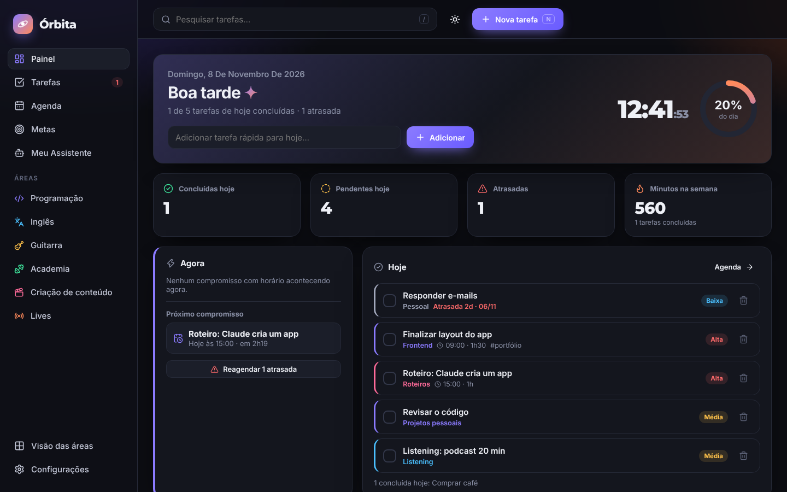
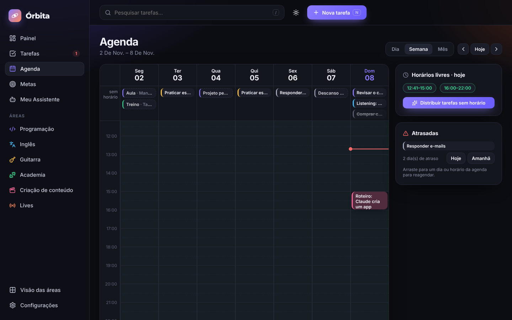
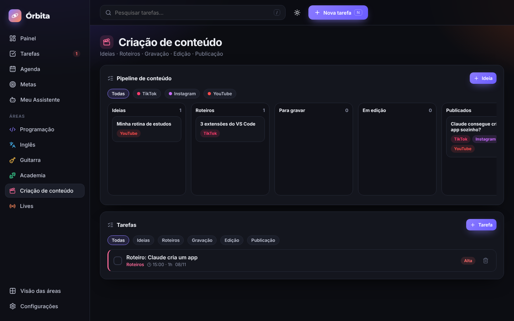
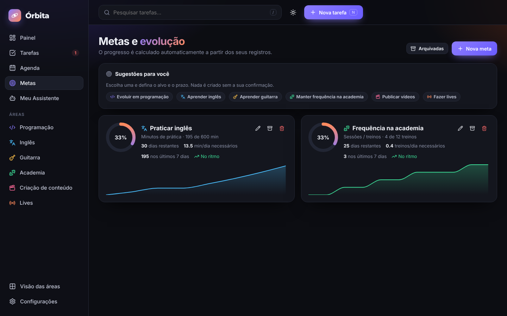
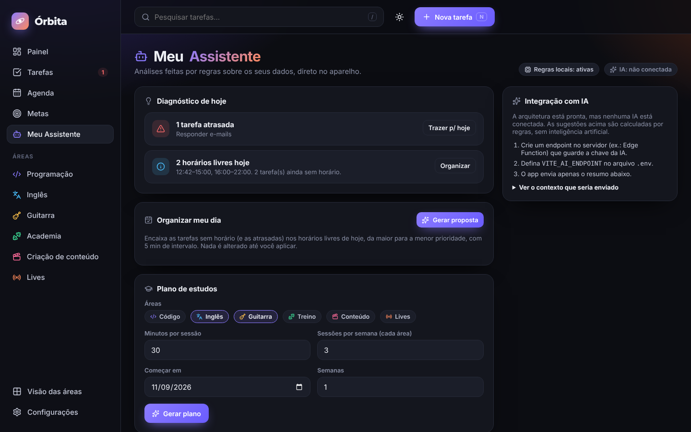
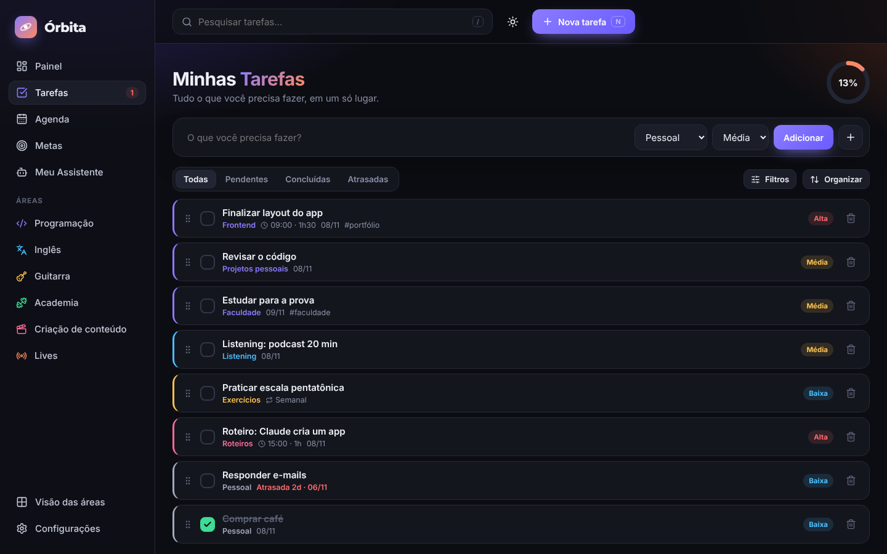
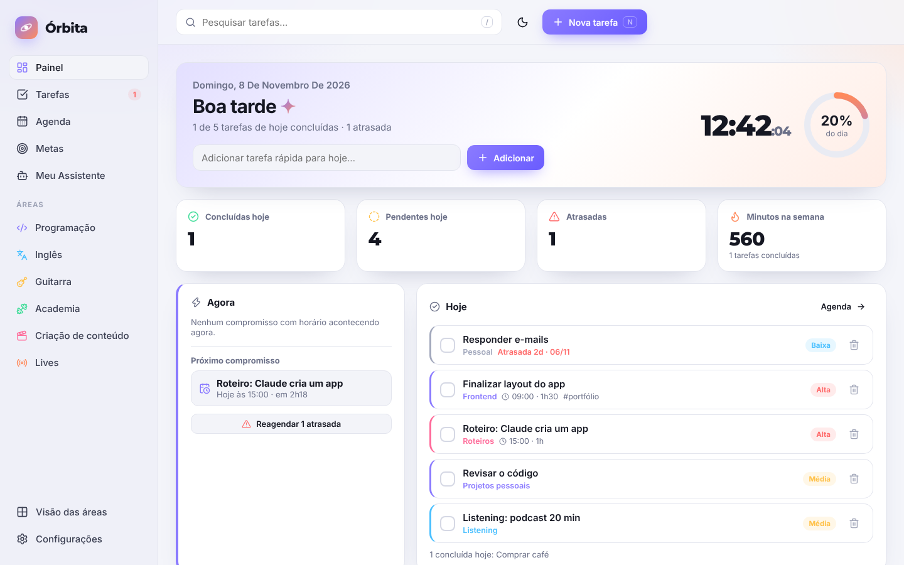
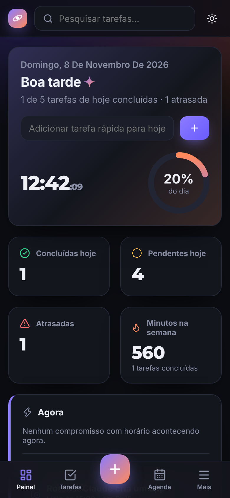
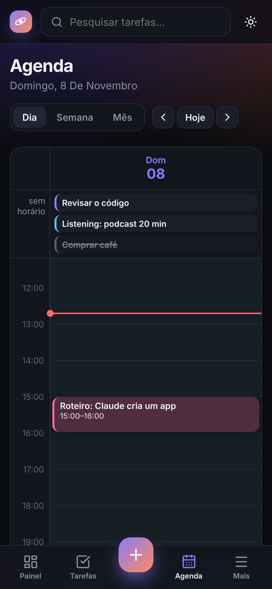
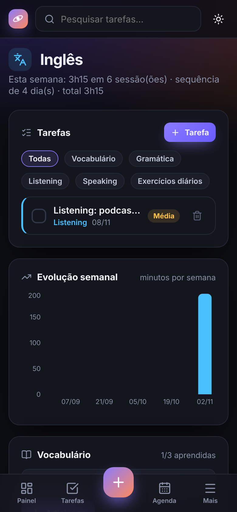

<div align="center">


# Órbita

**App gratuito de produtividade e rotina** — cada pessoa cria sua conta e organiza tarefas, agenda, áreas da vida e metas, sincronizado entre celular e computador.

React 19 · TypeScript · Vite · Zustand · Supabase (Auth + Postgres/RLS) · Recharts · dnd-kit · PWA

</div>



## Sobre o projeto

O Órbita começou como um app de tarefas em um único arquivo HTML (preservado em [`legacy/`](legacy/)) e evoluiu para uma aplicação React com arquitetura em camadas. A ideia é ter um painel que mostra **o que importa agora**: o próximo compromisso, o que está atrasado, quanto tempo livre sobra no dia e como estão as metas.

Com o Supabase configurado, o Órbita vira um serviço multiusuário: página inicial pública, cadastro com e-mail ou Google, recuperação de senha e sincronização entre aparelhos. Sem configurar nada, ele roda em **modo local**: tudo fica salvo no navegador, sem login.

> Desenvolvido por Matheus Palhano Lunga com assistência de ferramentas de inteligência artificial (Claude, da Anthropic) no planejamento, na implementação e na documentação.

## Funcionalidades

**Contas e sincronização**
- Página inicial pública, cadastro, login com **e-mail e senha** ou **Google**, **recuperação de senha**
- Dados isolados por usuário (Row Level Security no Postgres)
- Sincronização **por item** entre aparelhos, com fila offline: funciona sem internet e envia quando a conexão volta
- Sair apaga os dados do aparelho (computadores compartilhados); **excluir conta** apaga tudo do servidor
- Política de privacidade e termos de uso (LGPD)

**Painel**
- Saudação personalizada, data e relógio em tempo real
- Progresso do dia, concluídas, pendentes e atrasadas
- “Agora” e próximo compromisso (inclui blocos fixos da rotina)
- Gráfico de produtividade (14 dias), resumo da semana e metas em andamento
- Adição rápida de tarefa

**Tarefas**: tudo o que o protótipo original fazia, mais o que veio depois
- Adicionar, concluir, excluir, filtrar (todas / pendentes / concluídas / atrasadas)
- Organizar por prioridade, arrastar e soltar para reordenar, limpar concluídas
- Pesquisa sem acento (`/` foca a busca, `N` cria tarefa)
- Áreas e subcategorias, prioridades, etiquetas personalizadas, observações
- Data, horário, duração, lembrete e **recorrência** (diária ou em dias da semana)

**Agenda inteligente**
- Visões **dia, semana e mês**
- **Arrastar e soltar** entre horários e dias (mouse e toque)
- Rotina semanal com compromissos fixos e blocos flexíveis
- Horários livres calculados e destacados
- Tarefa não concluída **continua pendente** como atrasada e pode ser reagendada (Hoje / Amanhã / arrastar)
- Distribuição automática das tarefas sem horário nos espaços livres

**Áreas personalizáveis**: cada pessoa cria as suas (nome, cor, ícone, subcategorias) e liga as ferramentas que fazem sentido para cada área. Há dois modelos prontos: *Básico* (Pessoal, Estudos, Trabalho, Saúde) e *Estudante e criador de conteúdo*:
| Área | Recursos |
|---|---|
| Programação | Backend, Frontend, Faculdade, Projetos, Estudos, GitHub/portfólio · registro de estudo · habilidades |
| Inglês | Registro por habilidade (listening, speaking…) · vocabulário com “aprendida” · níveis por habilidade |
| Guitarra | Tempo de prática · acordes (aprendendo/dominado) · músicas com progresso · habilidades |
| Academia | Registro de treinos · mapa de frequência (16 semanas) · meta semanal |
| Criação de conteúdo | Kanban Ideia → Roteiro → Gravar → Edição → Publicado · TikTok, Instagram e YouTube · roteiro |
| Lives | Planejamento (data, início, duração, meta) · histórico com resultados · estatísticas |

**Metas**: alvo, prazo, progresso calculado a partir dos registros reais (tarefas, minutos, sessões, vídeos publicados, lives) ou manual, histórico em gráfico, ritmo necessário por dia e indicador “no ritmo / abaixo do ritmo”.

**Meu Assistente**: motor de **regras determinísticas** que identifica tarefas atrasadas, sobrecarga do dia, horários livres, blocos sem horário e metas abaixo do ritmo. Monta uma proposta para organizar o dia e gera planos de estudo nos horários livres. **Não usa IA**; a camada de integração já está preparada (veja [Arquitetura](docs/ARCHITECTURE.md#assistente-e-ia)).

**Também tem**: modo claro/escuro · notificações de lembrete · salvamento automático · histórico de atividades · exportação (JSON e CSV) e importação de backup · importação das tarefas do protótipo original · PWA instalável com experiência de app no celular (barra inferior, botão central, folhas modais).

## Capturas de tela

| Agenda (semana) | Conteúdo (kanban) |
|---|---|
|  |  |
| **Metas** | **Meu Assistente** |
|  |  |
| **Tarefas** | **Modo claro** |
|  |  |

<p align="center">
  
  
  
</p>

> As capturas usam dados de exemplo.

## Tecnologias

| Camada | Escolha | Por quê |
|---|---|---|
| UI | React 19 + TypeScript | Componentes tipados e reutilizáveis |
| Build | Vite | Dev server instantâneo, code-splitting por rota |
| Estado | Zustand + `persist` | Store simples com salvamento automático no `localStorage` |
| Rotas | React Router | Navegação por URL, rotas carregadas sob demanda |
| Gráficos | Recharts | Gráficos responsivos e interativos |
| Arrastar e soltar | dnd-kit | Suporte a mouse **e toque** |
| Ícones / fontes | lucide-react · Inter · Montserrat | Fontes empacotadas localmente (sem CDN) |
| Testes | Vitest | Regras de negócio testadas sem navegador |
| Nuvem (opcional) | Supabase Auth + Postgres com RLS | Login e sincronização por usuário |

## Como rodar

Requisitos: Node.js 20+.

```bash
git clone https://github.com/<seu-usuario>/orbita.git
cd orbita
npm install
npm run dev        # http://localhost:5173
```

| Script | Faz |
|---|---|
| `npm run dev` | Servidor de desenvolvimento |
| `npm run build` | Checagem de tipos + build de produção em `dist/` |
| `npm run preview` | Serve o build localmente |
| `npm test` | Testes unitários (Vitest) |
| `npm run lint` | Lint (oxlint) |

### Rotina pessoal privada (opcional)

Para carregar sua própria rotina no primeiro acesso sem publicá-la, crie `src/seed/personal.local.ts` (já está no `.gitignore`):

```ts
import type { RoutineBlock } from '../domain/types';
const routine: Omit<RoutineBlock, 'id'>[] = [
  { weekday: 1, title: 'Aula', area: 'programacao', period: 'manha', fixed: true },
];
export default { name: 'Seu nome', routine };
```

### Ativar contas (Supabase)

Copie `.env.example` para `.env`, preencha `VITE_SUPABASE_URL` e `VITE_SUPABASE_ANON_KEY` e rode [`supabase/schema.sql`](supabase/schema.sql) no SQL Editor do seu projeto. O passo a passo completo, incluindo o Google, os e-mails e a Vercel, está em **[docs/DEPLOY.md](docs/DEPLOY.md)**.

## Publicar

Siga o **[guia de publicação](docs/DEPLOY.md)**: GitHub → Supabase → Vercel → Google, tudo nos planos gratuitos.

## Estrutura de pastas

```
orbita/
├── legacy/                 # protótipo original em HTML (referência)
├── public/                 # ícones, manifest PWA, service worker
├── supabase/              # schema.sql (tabela, RLS, exclusão de conta) + teste de segurança
├── docs/                   # arquitetura, texto do LinkedIn, capturas
└── src/
    ├── domain/             # regras de negócio puras (sem React) + testes
    │   ├── types.ts        # modelo de dados
    │   ├── tasks.ts        # recorrência, atrasadas, filtros, ordenação
    │   ├── schedule.ts     # horários livres, sobrecarga, próximo compromisso
    │   ├── goals.ts        # progresso, histórico e ritmo das metas
    │   ├── stats.ts        # produtividade, semana, sequências
    │   └── assistant.ts    # motor de regras do assistente
    ├── store/              # Zustand (persistência, ações, migração de dados)
    ├── sync/               # sincronização por item (diff, fila offline, engine) + testes
    ├── services/           # Supabase (auth + backend de sync), notificações, interface de IA
    ├── config/site.ts      # nome do responsável e e-mail de contato (páginas legais)
    ├── components/         # UI reutilizável (Card, Modal, Ring, TaskItem, TaskForm…)
    ├── layout/AppShell.tsx # barra lateral, topo e navegação inferior no celular
    ├── pages/              # Painel, Tarefas, Agenda, Áreas, Metas, Assistente, Config.
    ├── seed/               # dados padrão, exemplo e (privado) rotina pessoal
    └── styles/global.css   # design system (tokens de cor, temas, responsivo)
```

Detalhes técnicos: [docs/ARCHITECTURE.md](docs/ARCHITECTURE.md).

## Testes

- **24 testes unitários** (`npm test`): recorrência, atrasadas, horários livres, sobrecarga, assistente, metas, migração de dados e **sincronização** (diferenças, conflitos com edição pendente, dois aparelhos convergindo, troca de usuário).
- **Segurança do banco**: `supabase/tests/rls-check.mjs` sobe um Postgres local e verifica as regras (cada usuário só lê e escreve os próprios dados, visitante sem acesso, exclusão de conta em cascata). Todas as 10 verificações passam.
- **Ponta a ponta** com navegador headless durante o desenvolvimento: 28 verificações no modo local e 21 no modo com contas, com um backend simulado (cadastro, Google, senha errada, sincronização computador ↔ celular, sair, isolamento entre usuários, recuperação de senha, excluir conta). Esses scripts não fazem parte do repositório.
- Ainda não testado contra um projeto Supabase real: faça o roteiro da seção 8 do [guia de publicação](docs/DEPLOY.md) depois de configurar.

## Roadmap

- [ ] Conectar a IA do assistente via endpoint no servidor
- [ ] Notificações push com o app fechado (Web Push)
- [ ] Sincronização em tempo real (hoje: ao focar a aba e a cada 30 s)
- [ ] Testes de componentes (Testing Library) e E2E no CI

---

Licença: a definir antes de publicar (sugestão: MIT).
